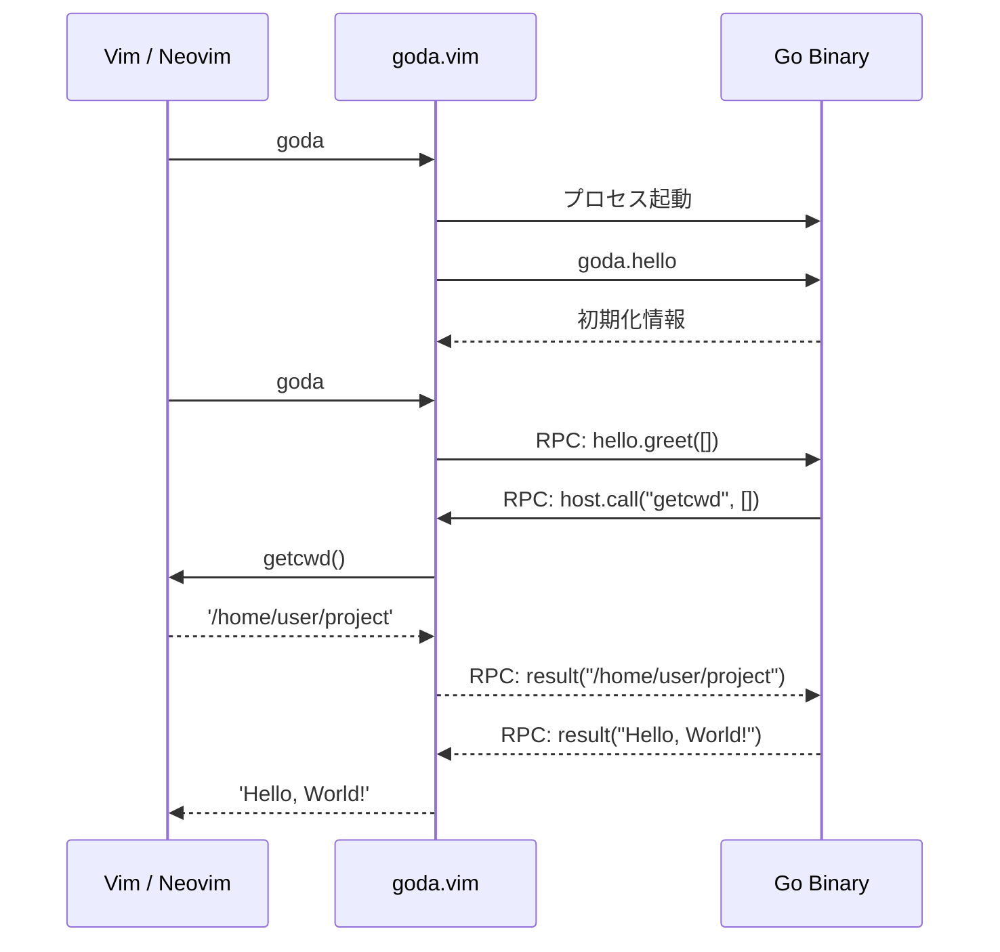

トリックオアトリート！
お菓子をくれなきゃあなたを今後Vim/Neovim/Emacsしか使えない体にします。こまもかです。

今週から一段と冷えこんできたこの頃ですが、こんな寒い季節は家に籠ってdotfilesを整備するのが相場と決まっています。
という訳で、Shougoさんの新作[goda.vim](https://github.com/Shougo/goda.vim)を使ってHello, worldする方法を解説していきます。

goda.vimを簡単に解説すると、GoでVim pluginを書けるようにするというものです。
DenoでVim pluginを書ける[denops.vim](https://github.com/vim-denops/denops-shared-server.vim)の精神的後継という立ち位置にいると僕は解釈しています。

開発の経緯は作者のShougoさんが書かれている記事を参照してください。

https://zenn.dev/shougo/articles/goda-cmp-vim-beta

なおこの記事では解説にあたりdenopsとGoの知識がある前提で解説します。

この記事で扱っているプラグインは以下のリポジトリで公開しています。

https://github.com/Comamoca/goda-hello

Nixが使える方は以下のコマンドでVimを起動し`:Greet`を実行することでgodaを使ったプラグインを試せます。

```sh
nix run github:comamoca/goda-hello
```

## どうやって動いているの
基本はdenopsと同じです。
msgpack-rpcを喋る外部プロセスをVimから起動して、Vimと外部プロセス間でデータの双方向送受信を行います。

以下の図はVimとgoda、Goの間でデータがやりとりされる様子を図にしたものです。



godaはVim PluginとGo Packageを提供していて、godaのSDKを用いてGoのプログラムを書くとgoda.vimから起動する前提のCLIが作成されます。
これをgoda.vim側から起動してメッセージを送ってやればGoプログラムをプラグインとして使えるようになる訳です。


## Hello, worldしてみよう
[denops-helloworld.vim](https://github.com/vim-denops/denops-helloworld.vim)を参考に、Hello, worldしてみます。
まずはプラグインの骨組を組んでいきます。

バイナリさえ読めれば良いので特に決まった形がある訳ではないのですが、[goda-cmp.vim](https://github.com/Shougo/goda-cmp.vim)を参考にしたプラグイン構成を以下に示します。


```
.
├── (flake.lock)
├── (flake.nix)
├── go.mod
├── go.sum
├── hello
│   ├── hello
│   └── main.go
└── plugin
    └── goda-hello.vim
```

プラグインルートの一段下にディレクトリを掘り、そこにGoパッケージを配置します。
Vim側のプログラムはいつも通り`plugin`に配置します。

Nixについては使用する必要はありませんが、プラグイン開発にGoが必要となるため開発環境の構築とpluginの配布に便利（後述）なので使った方が良いです。


プラグインの骨組が完成したら、ディレクトリをruntimepathへ追加しておきます。

```vim
set runtimepath^=path/to/goda-hello
```

## 実装していく

### Go
まず先にGo側のコードを実装していきます。

godaではgoda.vimの提供するGo SDKが必須です。そのためgo modを使う準備をします。
まず、以下のコマンドで`go.mod`を作成します。
`hello`の部分は骨組を作る際にGoのpackageを置くために作成したディレクトリと同じにします。

```shell
go mod init hello
go mod tidy
```

ビルドを行う際は以下のコマンドで行います。
`-o`を指定しているのは、指定しないとカレントに`hello`という実行ファイルを作成しようとしてエラーになるからです。
`-o`を指定すると「./hello内部にhelloという実行ファイルを出力する」という解釈になります。

```shell
go build -o hello ./hello/
```

以下がコードの全文です。

```go
package main

import (
	"context"
	"fmt"

	"github.com/Shougo/goda.vim/host"
	"github.com/Shougo/goda.vim/sdk"
)

type hello struct{}

func (hello) Name() string { return "hello" }

func (hello) Handlers() map[string]sdk.Handler {
	return map[string]sdk.Handler{
		"greet": func(ctx context.Context, h sdk.Host, params []any) (any, error) {
			cwd, err := h.Call(ctx, "getcwd")
			if err != nil {
				return nil, err
			}

			return fmt.Sprintf("hello, %v, from %s (cwd %v)", params[0], h.Meta().Host, cwd), nil
		},
	}
}

func main() { host.Main(hello{}) }
```
プラグインの本体は`hello`という構造体です。
この構造体は[Plugin](https://pkg.go.dev/github.com/Shougo/goda.vim/sdk#Plugin)を満たすように実装する必要があります。
Pluginの定義をGoDocから引用し、以下に示します。

```go
type Plugin interface {
	Name() string
	Handlers() map[string]Handler
}
```
シンプルですね。
`Name`はプラグインの名前、HandlersはVim側から`call goda#request`で呼び出す関数を定義します。
denopsでいうところの`denops.dispatcher`に相当する箇所です。

逆にGoからVimの関数やexコマンドを呼び出すには[Host](https://pkg.go.dev/github.com/Shougo/goda.vim/sdk#Host)構造体のメソッドを呼び出します。
denopsで言うところの[interface Denops](https://jsr.io/@denops/core/doc/~/Denops)に相当する箇所です。

それぞれのメソッドの違いを簡単に説明します。

- Call

同期的に関数を実行し、値を取得します。

- Notify

非同期で関数を実行します。値は受け取りません。

- Eval

Vim scriptを評価します。

- Cmd

exコマンドを実行します。

```go
type Host interface {
	Meta() Meta
	Call(ctx context.Context, fn string, args ...any) (any, error)
	Notify(ctx context.Context, fn string, args ...any) error
	Eval(ctx context.Context, expr string) (any, error)
	Cmd(ctx context.Context, cmd string) error
}
```
上記のサンプルコードでは以下の箇所でVimの関数を呼び出しています。
現在地を取得する`getcwd`関数を呼び出し、表示する文字列に含めています。

```go
cwd, err := h.Call(ctx, "getcwd")
if err != nil {
	return nil, err
}
return fmt.Sprintf("hello, %v, from %s (cwd %v)", params[0], h.Meta().Host, cwd), nil
```

Vim側が呼び出した際に渡してきた値は`params []any`から取得できます。
単純な配列なので存在チェックや型アサーションなどは自前でやる必要があります。

型アサーションに関して、denopsでは[unknownutil](https://github.com/jsr-core/unknownutil)というすばらしいライブラリがあったのですが、Goだと`value.(type)`でゴリゴリ型アサーションを書いていく感じになりそうです。

### Vim

次にVim側からGoで定義された関数を呼び出していきます。
以下のVim scriptはGo側で定義されている`greet`関数をgoda.vim経由で呼び出す`Greet`コマンドを定義しています。

```vim
call goda#start(simplify(getcwd() . '/hello/hello'))
command! -nargs=0 Greet echo goda#request('hello', 'greet', 'world')
```

このあたりはdenopsでもお馴染の`denops#request`と同じ感覚で扱えます。

## いつgoda#startすれば良いのか
godaには自動で`goda#start`するしくみが現状ありません。
そのためプラグイン側でstartする処理を書く必要があります。

`goda-cmp.vim`では`VimEnter`でプラグインがstartします。
startすること自体はそこまでコストがかからないと考えているため、案外起動時に実行しても良いのかもしれないです。

startするタイミングを選びたいのはユーザーも同じだと思うので、プラグイン側でstart関数を提供して初期化と併せて実行するのも良いかもしれません。

今回作成したプログラムでは、`goda#start`をwrapした`goda_hello#start`を公開します。プラグイン呼び出時にすでにstartしていればスキップし、startしていなければ`goda#start`を呼び出すようにしています。

引数として渡している`a:000`はVim scriptの関数で可変長引数を受け取るための変数で、ここで受け取った値はGoの`params`へ格納されます。

```vim
function! goda_hello#greet(...) abort
  if !goda#is_running()
    if empty(goda_hello#start())
      throw 'goda-hello: binary not found. Set g:goda_hello_bin or run `nix build`.'
    endif
  endif
  return call('goda#request', ['hello', 'greet'] + a:000)
endfunction
```

プラグインがloadされるまではGoバイナリを起動する必要はないので、この方法がもっぱらのケースで良いのではないかと思っています。

## Nixを用いたgoda pluginの配布
さて、冒頭で記述したNixについて最後に触れていきます。

これまで説明してきたように、godaはGoを使用してプラグインを作成します。
そのため、プラグインを使用する前にGoコードをコンパイルする必要があります。

Nixを使うと、Goのビルドも含めてVimプラグインをまとめてビルドし、それをVimのプラグインとして宣言的に管理できます。
もし仮にCGo等を使っている際にもNix側で再現性のあるビルドを行えるため、インストール時のトラブルを回避できます。

またNixを用いると「特定のプラグインがruntimepathにあるVim」を定義できるため、とりあえずプラグインを使ってもらうまでの敷居を極限まで下げられます。

冒頭でも紹介しましたが、以下のコマンドで今回扱ったHello, worldプラグインが使えるVimを起動できます。

```sh
nix run github:comamoca/goda-hello
```

denopsではDenoを使う都合上、依存関係を実行時に取得するのでNixによるパッケージングがかなり厳しかったのですが、godaではGoを用いるのでNixでのパッケージングがやりやすくなっています。

## まとめ
今回はGoでVim pluginを開発できるgoda.vimを解説しました。
goda.vimはまだ登場してから時間が経っておらず、まだエコシステムも大きくありません。

ですが、Goを使っているがゆえの起動速度の速さや動作の軽快さなど、個人的に期待しているプラグインでもあります。
今後はddu.vimのgoda版など、既存のShougowareのgoda版が出るそうなので楽しみです。
僕もgodaを使ってプラグインを作ってみようかなと思ったりしています。
